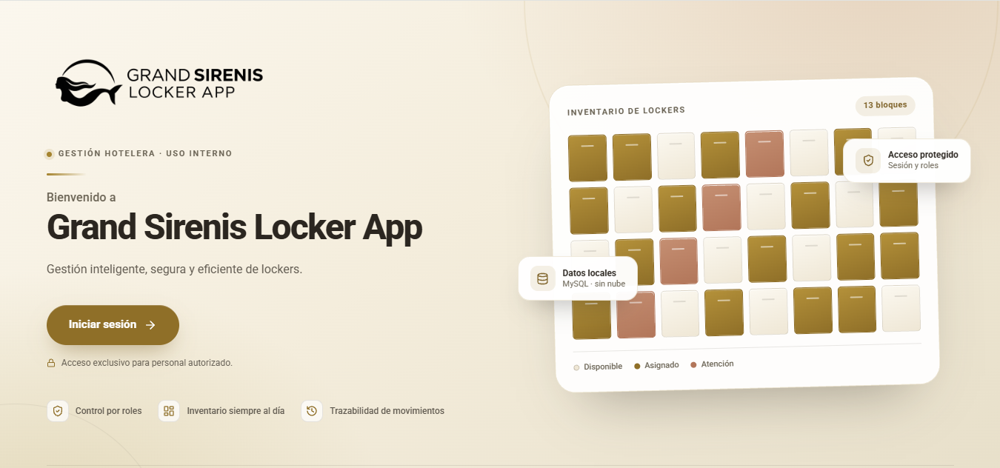
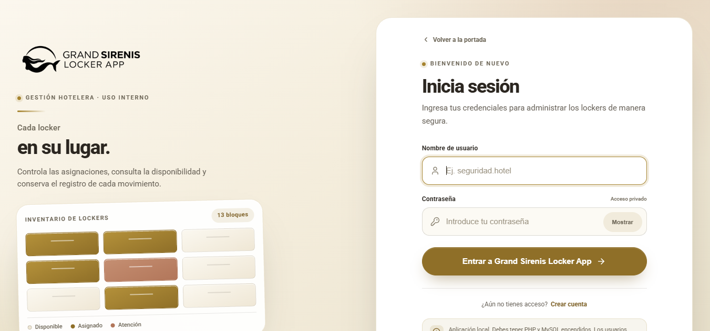

# Grand Sirenis Locker App · Gestión local de lockers para hotel

Aplicación local, ligera y segura para gestionar los lockers (casilleros) de los colaboradores de un hotel: dashboard, inventario (156 lockers), asignación, liberación, traslado, colaboradores, movimientos, incidencias y exportación CSV/JSON. Con autenticación por roles (administrador / operador) y PWA instalable. Sin frameworks pesados (no Laravel, React, Angular, Vue ni Electron). **Interfaz renovada: nuevas pantallas de offboarding, configuración, historial y gestión de lockers con diseño mejorado.**

<p align="center">
  
</p>

<div align="center">
  
  
  
</div>

---

## 🆕 Nuevas pantallas (UI renovada)

### Pantalla Salida de personal (#offboarding)
- **Hero navy** con acento dorado y stepper visual de 3 pasos (Buscar → Revisar → Confirmar).
- **Búsqueda** de colaboradores con normalización de acentos y mayúsculas.
- **Previsualización** de lockers asignados con avatar y contador.
- **Confirmación** con resumen de lockers a liberar y aviso destacado.
- **Informe final** con datos del colaborador, lockers procesados y motivo.

### Pantalla Configuración (#settings)
- **Hero** con chips informativos (datos locales, privado por sesión, sincronización manual).
- **Iconos de sección** con tonos del tema (azul, ámbar, dorado, teal, navy).
- **Mejor jerarquía** y responsive para móvil.

### Bitácora de movimientos (#history)
- **Hero navy** con chips: total de registros, coincidencias y orden cronológico.
- **Búsqueda** en tarjeta propia.
- **Timeline** con icono por tipo de movimiento, pill del locker y responsable.

### Gestión de lockers (#lockers)
- **Hero navy** con contadores: total, disponibles y no disponibles.
- **Pestañas** Inventario/Colaboradores tipo pill.
- **Tabla** en tarjeta con hover por fila.

---

## Tecnologías

### Frontend y PWA

[](https://developer.mozilla.org/en-US/docs/Web/HTML)
[](https://developer.mozilla.org/en-US/docs/Web/CSS)
[](https://developer.mozilla.org/en-US/docs/Web/JavaScript)
[](https://web.dev/progressive-web-apps/)
[](https://playwright.dev)

### Backend y base de datos

[](https://www.php.net)
[](https://mariadb.org)
[](https://www.mysql.com)
[](https://www.php.net/manual/en/book.pdo.php)

### Herramientas

[](https://git-scm.com)
[](https://www.apachefriends.org)
[](https://www.microsoft.com/windows)

---

## Stack tecnológico

| Capa                | Tecnología                                                                    | Versión                    |
| ------------------- | ----------------------------------------------------------------------------- | -------------------------- |
| **Frontend**        | HTML5, CSS3, JavaScript vanilla (sin frameworks)                              | ES6+                       |
| **Backend**         | PHP 8.2 (CLI, sin framework, consultas preparadas PDO)                        | 8.2.12                     |
| **Base de datos**   | MariaDB / MySQL (InnoDB, utf8mb4)                                             | 10.4.32 / 8+               |
| **Autenticación**   | Sesiones PHP (HttpOnly / SameSite=Lax), roles y CSRF                          | -                          |
| **Servidor**        | Servidor integrado de PHP                                                     | `php -S 127.0.0.1:8000`    |
| **PWA**             | Manifest + Service Worker (caché solo de assets estáticos)                    | -                          |
| **Pruebas**         | Playwright (Chromium del sistema)                                             | -                          |
| **Tipografía**      | Roboto variable autoalojada (WOFF2)                                           | -                          |
| **Iconos**          | Lucide empaquetado como sprite SVG local                                      | -                          |
| **Plataforma**      | Windows 10 (x64) + XAMPP para MySQL                                           | -                          |

---

## Estructura del proyecto

```text
Grand-Sirenis-Locker-app/
  public/                      # Expuesto por el servidor PHP
    index.php                  # Dashboard (SPA ligera, navegación por hash)
    login.php                  # Inicio de sesión
    register.php               # Registro de usuarios (restringido)
    logout.php                 # Cierre de sesión (POST + CSRF)
    setup.php                  # Redirige a register.php
    api.php                    # Endpoint único: CRUD, auditoría y exportaciones
    sw.js                      # Service Worker (PWA, caché de assets)
    manifest.webmanifest       # Manifiesto PWA (instalable)
    offline.html               # Página sin conexión
    assets/
      css/theme.css            # Tokens CSS y @font-face Roboto
      css/app.css              # Estilos del dashboard
      css/auth.css             # Estilos login y registro
      css/components.css       # Componentes globales (botones, tablas, modales)
      js/app.js                # Lógica del dashboard (render, filtros, modales, gráficos)
      js/auth.js               # Mostrar/ocultar contraseña y validación
      js/motion.js             # Precarga, revelado progresivo y animaciones
      fonts/roboto-*.woff2     # Tipografía Roboto variable local
      icons/lucide-sprite.svg  # Sprite de iconos Lucide (generado localmente)
      image/                   # Logos, favicon e icono Windows
  private/                     # No servido por php -S -t public
    config.php                 # Conexión MySQL (lee variables de entorno / .env)
    bootstrap.php              # PDO singleton, sesiones, CSRF, helpers de seguridad
  db/                          # Esquema y migraciones
    schema.sql                 # Creación de BD y tablas
    seed.sql                   # 156 lockers originales (solo instalación nueva)
    migrations/                # Migraciones versionadas
  scripts/                     # Utilidades PowerShell y PHP
    backup-database.ps1        # Respaldo SQL de la base de datos
    setup-test-db.ps1          # Base de pruebas aislada
    run-e2e.ps1                # Ejecuta las pruebas E2E de Playwright
    inspect-users.php          # Lista usuarios de la BD (solo lectura)
    reset-admin-user.php       # Restablece el administrador (contraseña por env/STDIN)
  tests/
    e2e/app.spec.js            # Pruebas E2E integrales
    e2e/auth.spec.js           # Pruebas de autenticación
    e2e/identity-verify.spec.js# Verificación de identidad visual y recursos estáticos
  docs/                        # Documentación técnica
    ARCHITECTURE.md            # Arquitectura y decisiones
    DATABASE_SCHEMA.md         # Esquema de la base de datos
    CHANGELOG.md               # Historial de cambios
    BACKLOG.md                 # Tareas pendientes
    SESSION_STATE.md           # Estado de la sesión de trabajo
    DECISIONS.md               # Decisiones técnicas registradas
    DIAGNOSTICO.md             # Diagnóstico inicial del proyecto
    AI_WORKLOG.md              # Bitácora de trabajo asistido
    ASSET_LICENSES.md          # Licencias de recursos visuales
```

---

## Comandos principales

### Servidor de desarrollo (un solo comando)

```powershell
# Desde la raíz del proyecto
.\iniciar-servidor.bat

# O manualmente con PHP de XAMPP
& "C:\xampp\php\php.exe" -S 127.0.0.1:8000 -t public
```

El servidor atiende solo la carpeta `public/`. MySQL debe estar encendido por separado (XAMPP). Abre **http://127.0.0.1:8000/** (Welcome Page).

### Pruebas E2E (base aislada)

```powershell
# Recrea la base de pruebas, arranca PHP en el 8001 y ejecuta Playwright
powershell -NoProfile -ExecutionPolicy Bypass -File scripts/run-e2e.ps1
```

La suite ejecuta pruebas contra la base de pruebas aislada (datos sintéticos). No toca la base de desarrollo ni datos reales.

### Respaldo de base de datos

```powershell
# Exporta la base de datos a storage/backups/ con fecha
powershell -NoProfile -ExecutionPolicy Bypass -File scripts/backup-database.ps1
```

Obligatorio antes de cualquier operación sobre la base de datos real.

### Utilidades PHP

```powershell
# Listar usuarios actuales (solo lectura)
C:\xampp\php\php.exe scripts/inspect-users.php

# Restablecer el administrador (contraseña por variable de entorno o STDIN, nunca en código)
$env:LOCKERFLOW_RESET_PASSWORD = 'tu_contraseña_segura'
C:\xampp\php\php.exe scripts/reset-admin-user.php --user=tu_usuario --role=administrador
```

---

## Requisitos del entorno

| Herramienta     | Versión                    | Uso                            |
| --------------- | -------------------------- | ------------------------------ |
| PHP             | 8.2.12 (con pdo, pdo_mysql, session) | Backend y servidor integrado |
| MariaDB / MySQL | 10.4.32 / 8+               | Base de datos (localhost:3306) |
| Node.js         | 26.13.0 / npm 11.19.1      | Pruebas E2E con Playwright     |
| Git             | 2.54.0                     | Control de versiones           |
| Navegador       | Chrome o Edge (sistema)    | Playwright y uso diario        |

---

## Configuración del entorno

### Variables de entorno (`.env`)

El archivo `.env` **no se versiona**. Copia `.env.example` a `.env` y configura los valores con tus credenciales reales.

| Variable                        | Descripción                                        | Ejemplo                    |
| ------------------------------- | -------------------------------------------------- | -------------------------- |
| `DB_HOST`                       | Host de MySQL                                      | `127.0.0.1`                |
| `DB_PORT`                       | Puerto de MySQL                                    | `3306`                     |
| `DB_NAME`                       | Nombre de la base de datos                         | `sirenis_locker_db`        |
| `DB_USER`                       | Usuario de aplicación (privilegios mínimos)        | `owenpusey`                |
| `DB_PASSWORD`                   | Contraseña de aplicación                           | `tu_contraseña_segura`     |
| `TIME_ZONE`                     | Zona horaria                                       | `America/Bogota`           |

El usuario de aplicación tiene solo `SELECT, INSERT, UPDATE, DELETE` sobre la base de datos configurada. **Nunca uses `root` en la aplicación.**

### Primera instalación

1. En phpMyAdmin, crea la base de datos (por defecto `sirenis_locker_db`), importa **`db/schema.sql`** y, solo en una instalación nueva, importa **`db/seed.sql`** (156 lockers).
2. Copia `.env.example` a `.env` y configura `DB_NAME`, `DB_USER` y `DB_PASSWORD`.
3. Inicia PHP: `php -S 127.0.0.1:8000 -t public` (o `.\iniciar-servidor.bat`).
4. Abre **http://127.0.0.1:8000/register.php** desde el mismo equipo. El primer registro crea automáticamente el **administrador principal**.
5. Para futuros accesos, abre **http://127.0.0.1:8000/login.php**.

> **Nota:** PHP y MySQL son servicios separados. `php -S` solo inicia PHP: mantén MySQL activo. No abras los archivos `.php` con doble clic. No expongas PHP ni MySQL a internet.

---

## Autenticación y acceso

- **Registro inicial:** solo cuando no hay usuarios y el navegador se conecta desde el mismo equipo servidor (`localhost`). Crea la primera cuenta **Administrador** y comienza sesión.
- **Registro posterior:** no es público. Un Administrador autenticado puede crear cuentas adicionales desde **＋ Crear usuario**. Un Operador no puede crear usuarios.
- **Roles:** `administrador` (crea cuentas y administra lockers) y `operador` (administra lockers, consulta gráficos y movimientos; no crea cuentas).
- **Seguridad:** contraseñas con `password_hash`, sesión `HttpOnly`/`SameSite=Lax`, regeneración de ID de sesión, token CSRF en formularios y cabecera `X-CSRF-Token` para la API, cabeceras de seguridad (CSP, `X-Content-Type-Options`, `X-Frame-Options: DENY`, `Referrer-Policy`, `Cache-Control: no-store`).
- El bloqueo de lockers es **administrativo**, no controla cerraduras físicas.

---

## API Endpoints

Base: `api.php?resource=<recurso>`. Las peticiones de escritura son `POST` con JSON y el token CSRF en la cabecera `X-CSRF-Token`. Todas las respuestas usan el envelope `{ ok, message, data? }`.

### Bootstrap y exportación

| Ruta                              | Método         | Descripción                              |
| --------------------------------- | -------------- | ---------------------------------------- |
| `api.php?resource=bootstrap`      | GET            | Datos iniciales: lockers, movimientos, usuario, CSRF, hora del servidor |
| `api.php?resource=export&type=inventory` | GET   | CSV del inventario de lockers            |
| `api.php?resource=export&type=history`   | GET   | CSV del historial de movimientos         |
| `api.php?resource=export&type=backup`    | GET   | JSON respaldo completo (solo administrador) |

### Operaciones sobre lockers

| Ruta                              | Método         | Descripción                              |
| --------------------------------- | -------------- | ---------------------------------------- |
| `api.php?resource=assign`         | POST           | Asigna un locker disponible a un colaborador (transacción MySQL) |
| `api.php?resource=release`        | POST           | Libera un locker asignado y registra el movimiento |
| `api.php?resource=transfer`       | POST           | Traslada a un colaborador entre dos lockers |
| `api.php?resource=status`         | POST           | Cambia el estado físico de un locker (Dañado, Bloqueado, etc.) |
| `api.php?resource=edit`           | POST           | Edita datos de una asignación activa |
| `api.php?resource=reconcile`      | POST           | Valida y reconcilia inconsistencias de datos |

Cada operación guarda `snapshot_before` / `snapshot_after` (JSON) y el actor, formando una pista de auditoría inmutable desde la aplicación.

---

## Base de datos

La aplicación usa una base de datos MariaDB/MySQL (utf8mb4, InnoDB) con las tablas:

- `users` — cuentas de acceso con roles (`administrador`, `operador`).
- `lockers` — 156 lockers con bloque, número, estado, titular, departamento, fechas e indicadores de calidad.
- `movements` — bitácora de auditoría con acción, locker, responsable y snapshots JSON (`before` / `after`).

Las migraciones versionadas en `db/migrations/` aplican endurecimiento del esquema, rol por defecto `operador`, inmutabilidad de la bitácora, privilegios mínimos y coherencia estado/titular.

El nombre de la base de datos, el usuario y la contraseña se configuran en `.env` (no versionado).

---

## Estado de calidad

| Componente | Comando                     | Resultado              |
| ---------- | --------------------------- | ---------------------- |
| PHP syntax | `php -l` sobre los PHP      | Sin errores de sintaxis |
| JS syntax  | `node --check` sobre los JS | Sin errores de sintaxis |
| Pruebas E2E| Playwright (Chromium)       | Superadas              |
| PWA        | Service Worker              | Activo y controlando la página |
| Accesibilidad | Contraste, foco, ARIA, objetivos táctiles | Verificado en 6 resoluciones |

El proyecto se mantiene actualizado en este repositorio. Cada cambio relevante se registra en `docs/CHANGELOG.md`, `docs/AI_WORKLOG.md` y `docs/SESSION_STATE.md`.
